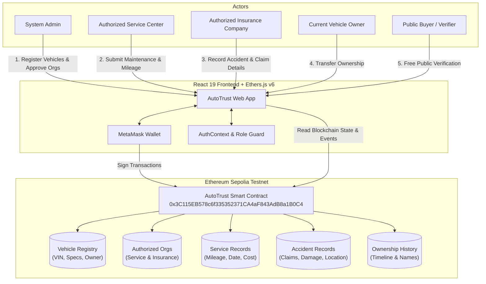

# AutoTrust — Decentralized Vehicle History & Verification Platform

> **"Verify Before You Buy."**  
> An immutable, blockchain-anchored Digital Vehicle Passport eliminating odometer tampering, hidden accident damage, and counterfeit service histories in the pre-owned vehicle market.

---

## 📌 Problem Statement

The secondary vehicle market suffers from severe information asymmetry:
- **Odometer Fraud:** Mileage readings are routinely rolled back before resale.
- **Concealed Accident Damage:** Severe structural damages and insurance write-offs are hidden from prospective buyers.
- **Falsified Maintenance Logs:** Paper service booklets and centralized databases can be fabricated, modified, or lost.
- **Title Washing:** Ownership history and lien statuses are easily obscured across jurisdictions.

**AutoTrust** solves this by establishing a single source of truth anchored to the Ethereum blockchain. Every vehicle registration, service record, accident claim, and ownership change is cryptographically signed and permanently stored on-chain.

---

## ✨ Key Features

- **Public Vehicle Passport (No Login Required):**
  - Instant lookup by vehicle registration number.
  - Comprehensive timeline tracking manufacturing specs, maintenance logs, accident reports, and ownership changes.
  - Verified badges and direct links to Sepolia Etherscan transaction proofs.

- **Role-Based Web3 Access Control:**
  - Dynamic on-chain role determination queried directly from the smart contract (`admin()`, `isServiceCenter()`, `isInsuranceCompany()`, and vehicle owner mappings).
  - Protected route wrappers preventing unauthorized wallet actions.

- **Admin Operations:**
  - Register new vehicles on-chain with VIN, engine number, chassis number, specs, and initial owner wallet/name.
  - Approve authorized Service Centers and Insurance Companies with registered business names.

- **Service Center Operations:**
  - Record maintenance events with date, service type, odometer reading, and verified repair costs.
  - Enforces that only approved service center wallets can submit maintenance records for registered vehicles.

- **Insurance Provider Operations:**
  - File immutable accident and damage claims detailing incident date, description, approved repair cost, accident location, and claim settlement amount.

- **Vehicle Owner Operations:**
  - Securely transfer vehicle ownership on-chain to a new owner wallet and name.
  - Cryptographically verifies that only the current registered owner can initiate an ownership transfer.

---

## 🛠 Technology Stack

### Frontend Application
- **Framework:** React 19 + Vite 8
- **Routing:** React Router v7 (with protected route guards)
- **Styling:** Tailwind CSS v3
- **Animations:** Framer Motion
- **Icons:** Lucide React
- **Web3 Integration:** Ethers.js v6 + MetaMask Browser Provider

### Smart Contract & Blockchain
- **Smart Contract Language:** Solidity `^0.8.24`
- **Development & Compilation:** Hardhat
- **Network:** Ethereum Sepolia Testnet
- **Contract Address (Sepolia):** `0x3C115EB578c6f335352371CA4aF843AdB8a1B0C4`

---

## 🏗 System Architecture & Workflow



---

## 📁 Project Structure

```
autotrust/
├── blockchain/                      # Smart Contract & Hardhat Workspace
│   ├── contracts/
│   │   └── AutoTrust.sol           # Core AutoTrust Solidity contract
│   ├── scripts/
│   │   ├── deploy.js               # Contract deployment script
│   │   ├── deployFresh.js          # Deployment utility
│   │   └── checkStatus.js          # On-chain state verification script
│   ├── hardhat.config.js           # Hardhat network & compiler configuration
│   ├── package.json                # Blockchain dependencies
│   └── .env.example                # Blockchain environment template
├── src/                             # Frontend Source Code
│   ├── components/
│   │   ├── layout/                 # Sidebar, Topbar, Layout wrappers
│   │   ├── ui/                     # Reusable UI components (Button, Card, Badge, etc.)
│   │   └── ProtectedRoute.jsx      # Role-based route protection
│   ├── context/
│   │   └── AuthContext.jsx         # Web3 authentication & on-chain role resolution
│   ├── lib/
│   │   ├── ethereum.js             # Ethers.js v6 provider & contract connection
│   │   ├── AutoTrustABI.json       # Contract Application Binary Interface
│   │   └── utils.js                # Style & class utilities
│   ├── pages/
│   │   ├── public/                 # LandingPage, VehiclePassport, VerificationResult
│   │   ├── admin/                  # AdminDashboard, VehicleManagement, OrganizationManagement
│   │   ├── service/                # ServiceDashboard, AddServiceRecord
│   │   ├── insurance/              # InsuranceDashboard, AddAccidentRecord
│   │   └── owner/                  # OwnerDashboard (Ownership Transfer)
│   ├── router.jsx                  # Application route definitions
│   ├── App.jsx                     # Application root
│   └── main.jsx                    # Vite entry point
├── .env.example                     # Project environment template
├── .gitignore                       # Production gitignore
├── package.json                     # Frontend dependencies & scripts
├── tailwind.config.js               # Tailwind styling configuration
└── vite.config.js                   # Vite configuration
```

---

## 🚀 Getting Started

### Prerequisites

- **Node.js:** v18.0.0 or higher
- **npm:** v9.0.0 or higher
- **MetaMask Browser Extension:** Configured with the **Ethereum Sepolia** testnet.
- **Sepolia ETH:** Testnet ETH to cover gas fees for on-chain transactions.

---

### Installation

1. **Clone the repository:**
   ```bash
   git clone <repository-url>
   cd autotrust
   ```

2. **Install frontend dependencies:**
   ```bash
   npm install
   ```

3. **Install smart contract dependencies (optional, for contract development):**
   ```bash
   cd blockchain
   npm install
   cd ..
   ```

---

### Environment Configuration

1. **Root Environment Template:**
   Copy `.env.example` to `.env` if custom variables are required.

2. **Blockchain Environment Configuration:**
   For deploying or running Hardhat tasks, configure `blockchain/.env`:
   ```bash
   cp blockchain/.env.example blockchain/.env
   ```
   Fill in your configuration:
   ```env
   SEPOLIA_RPC_URL="https://eth-sepolia.g.alchemy.com/v2/YOUR_ALCHEMY_API_KEY"
   PRIVATE_KEY="your_deployer_wallet_private_key"
   ```

> ⚠️ **CRITICAL SECURITY NOTICE:** Never commit your `.env` file or private keys. The repository `.gitignore` is pre-configured to strictly exclude sensitive credentials.

---

### Running the Application

1. **Start the frontend development server:**
   ```bash
   npm run dev
   ```
   The application will be live at `http://localhost:5173`.

2. **Run linting checks:**
   ```bash
   npm run lint
   ```

3. **Build for production:**
   ```bash
   npm run build
   ```

4. **Preview production build:**
   ```bash
   npm run preview
   ```

---

## ⛓ Smart Contract Deployment (Hardhat)

The project is currently connected to the deployed Sepolia contract:  
**`0x3C115EB578c6f335352371CA4aF843AdB8a1B0C4`**

To compile or redeploy your own contract instance:

1. **Compile the contract:**
   ```bash
   cd blockchain
   npx hardhat compile
   ```

2. **Deploy to Ethereum Sepolia:**
   ```bash
   npx hardhat run scripts/deploy.js --network sepolia
   ```

3. **Update the frontend target address:**
   Update `CONTRACT_ADDRESS` in `src/lib/ethereum.js` and update `src/lib/AutoTrustABI.json` if the contract interface changes.

---

## 📸 Screenshots

| Public Vehicle Passport | Verification & Timeline |
| :---: | :---: |
| *[Screenshot Placeholder: Public Vehicle Passport Overview]* | *[Screenshot Placeholder: Maintenance & Accident Timeline]* |

| Admin Management | Service & Claim Reporting |
| :---: | :---: |
| *[Screenshot Placeholder: Vehicle & Organization Admin]* | *[Screenshot Placeholder: Add Service / Report Accident Form]* |

---

## ⚠️ Known Limitations & Future Enhancements

- **Decentralized Storage (IPFS / Arweave):** Current implementation anchors core metadata, costs, and hashes on-chain. Future updates will incorporate decentralized document storage for PDF inspection sheets and repair invoices.
- **Multi-Chain Support:** Expanding to Ethereum Layer-2 rollups (Arbitrum, Base, Optimism) to drastically reduce gas costs for high-frequency maintenance logs.
- **Automated IoT Telemetry:** Direct integration with connected-vehicle OBD-II telematics for real-time odometer logging.
- **NFT Vehicle Titles:** Representing vehicle ownership titles as ERC-721 or ERC-1155 tokens to enable trustless escrow and instant cross-border vehicle sales.

---

## 📄 License

This project is licensed under the [MIT License](LICENSE).
